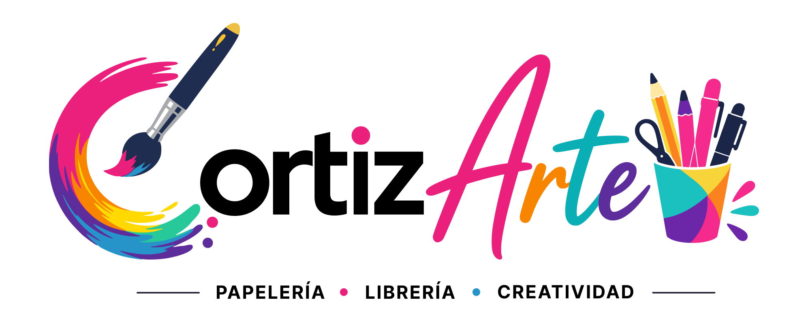
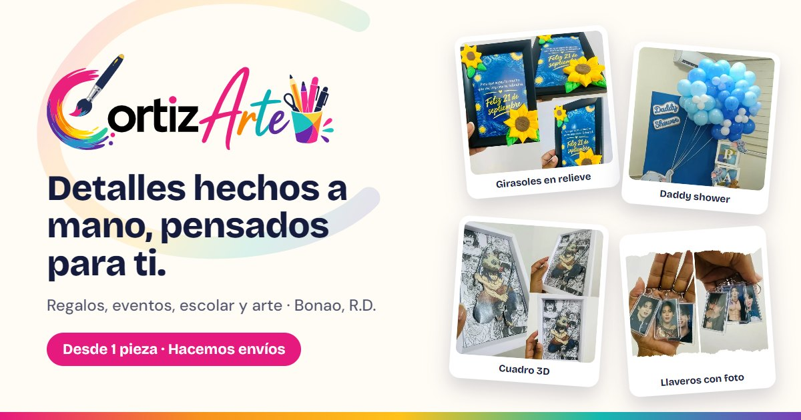
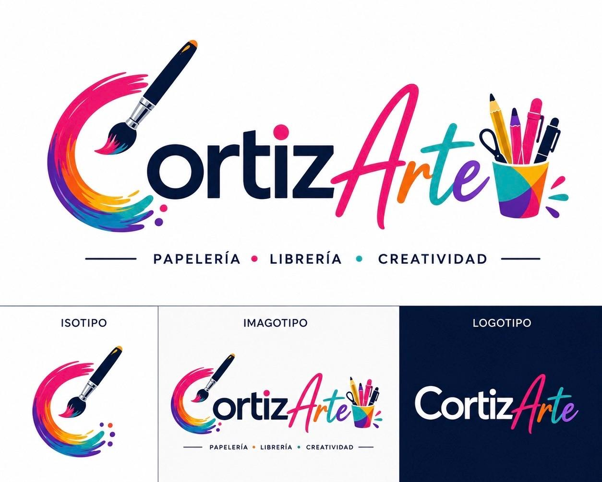

<p align="center">
  
</p>

# Cortizarte — Landing



Landing page de **Cortizarte**, el taller creativo de Rosa Ángela Cuello Ortiz en Bonao, República Dominicana: regalos personalizados, decoración de eventos, material escolar y arte por encargo. Desde 1 pieza, con envíos.

La página está pensada para convertir por WhatsApp: muestra trabajos reales y cada pedido termina en un mensaje ya armado para Rosa Ángela.

## Qué incluye

- **Hero "La gran C"**: la pincelada del logo se pinta al entrar, rodeada de trabajos recortados como stickers.
- **Qué sale del taller**: cuatro franjas de color (Regalos, Eventos, Escolar, Arte), una por color del logo.
- **Tendedero**: carrusel infinito de polaroids que avanza solo y se arrastra con mouse o dedo.
- **Vista ampliada**: cada foto crece desde su lugar, con botón *Quiero algo así* que abre WhatsApp con el trabajo mencionado.
- **Orden de trabajo**: formulario que arma el mensaje de WhatsApp (encargo, ocasión, fecha, cantidad e idea).
- **Animaciones de entrada por scroll**, reversibles, y respeto a *reducir movimiento*.
- Responsiva de 375 px en adelante.

## Stack

HTML estático + [Tailwind CSS v3](https://v3.tailwindcss.com) compilado + JavaScript sin dependencias. Tipografías de Google Fonts: Bricolage Grotesque, DM Sans y Caveat.

## Estructura

```
index.html            Página completa (marcado, estilos propios y scripts)
styles.css            Tailwind compilado y minificado (no editar a mano)
tailwind.css          Entrada de Tailwind
tailwind.config.js    Colores y tipografías de la marca
og-image.jpg          Imagen de vista previa al compartir el link (1200×630)
img/                  Trabajos reales en WebP
img/brand/            Imagotipo en PNG y manual de marca
Imagotipo-*.svg       Logo (header y footer)
Isotipo.svg           Ícono de la pestaña
```

## Marca

| Color | Hex | Uso |
|---|---|---|
| Tinta | `#141B3D` | Texto y footer |
| Papel | `#FFFBF5` | Fondo |
| Magenta | `#E6197F` | Botones · línea Regalos |
| Naranja | `#F7931E` | Línea Eventos |
| Amarillo | `#FFC21A` | Acentos |
| Turquesa | `#14B8B0` | Línea Escolar |
| Morado | `#7B3FB8` | Línea Arte · Detrás del pincel |



## Correr en local

Cualquier servidor estático sirve:

```bash
npx serve -l 8080
```

Y abrir `http://localhost:8080`.

## Recompilar estilos

Después de cambiar clases de Tailwind en `index.html`:

```bash
npx tailwindcss@3 -i tailwind.css -o styles.css --minify
```

## Publicación

- **Producción:** https://cortizarte.edu.do

Está en GitHub Pages, publicado desde la raíz de `main`: cada `git push` publica la nueva versión sola, sin paso de build porque `styles.css` ya va compilado. El archivo `CNAME` le indica a GitHub el dominio.

DNS en midominio.do (NIC.DO): cuatro registros **A** en la raíz hacia `185.199.108.153`, `185.199.109.153`, `185.199.110.153` y `185.199.111.153`, y un **CNAME** `www` → `elian-d.github.io`.

La vista previa al compartir el link usa direcciones completas (`og:url` y `og:image` en el `<head>`). Si el dominio cambia, hay que actualizarlas ahí y en `<link rel="canonical">`.

## Contacto

- WhatsApp: [+1 (829) 499-9794](https://wa.me/18294999794)
- Instagram: [@cortizarte](https://instagram.com/cortizarte)
